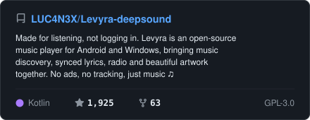

  <picture>
    <source media="(prefers-color-scheme: dark)" srcset="./assets/brand/luc4n3x-logo-dark.webp">
    <source media="(prefers-color-scheme: light)" srcset="./assets/brand/luc4n3x-logo.webp">
    
  </picture>

  
Independent developer in Italy. Mostly Android apps and audio software.

  

    <a href="https://luc4n3x.pages.dev">Website</a> ·
    <a href="https://levyra.dpdns.org">Levyra</a> ·
    <a href="https://github.com/LUC4N3X?tab=repositories">Repositories</a> ·
    <a href="https://github.com/sponsors/LUC4N3X">Sponsors</a>
  

  GitHub Developer Program

## About

I build software I want to use every day, mainly on Android and Linux. Most of my time goes into [Levyra](https://github.com/LUC4N3X/Levyra-deepsound). When I'm not working on the player, I usually write backend APIs or small self-hosted tools around media.

I care a lot about how an app holds up on a normal phone with strict background limits. If a bug comes back, I'd rather spend an evening reproducing it on real hardware than ship a workaround.

## Levyra

[Levyra](https://github.com/LUC4N3X/Levyra-deepsound) is an open-source music player for Android, Windows and Linux. I started it because I was tired of splitting my library between a streaming app and a folder of local files, and I didn't want another account just to keep playlists around.

Saved tracks stay on your storage as normal audio files, and lyrics sync from LRCLIB. It has no ads and no tracking. Android runs on Kotlin, Jetpack Compose and Media3, while the desktop builds use Compose Multiplatform with libVLC.

[Repository](https://github.com/LUC4N3X/Levyra-deepsound) · [Website](https://levyra.dpdns.org) · [Docs](https://levyra.dpdns.org/docs/) · [Releases](https://github.com/LUC4N3X/Levyra-deepsound/releases)

## On GitHub

  <a href="https://github.com/LUC4N3X/Levyra-deepsound">
    <picture>
      <source media="(prefers-color-scheme: dark)" srcset="./assets/stats/pin-dark.svg">
      <source media="(prefers-color-scheme: light)" srcset="./assets/stats/pin-light.svg">
      
    </picture>
  </a>
  <a href="https://github.com/LUC4N3X?tab=overview">
    <picture>
      <source media="(prefers-color-scheme: dark)" srcset="./assets/stats/stats-dark.svg">
      <source media="(prefers-color-scheme: light)" srcset="./assets/stats/stats-light.svg">
      
    </picture>
  </a>

## Contact

If you run into a bug or want to suggest something, open an issue on the repo. Everything else is on [luc4n3x.pages.dev](https://luc4n3x.pages.dev).
