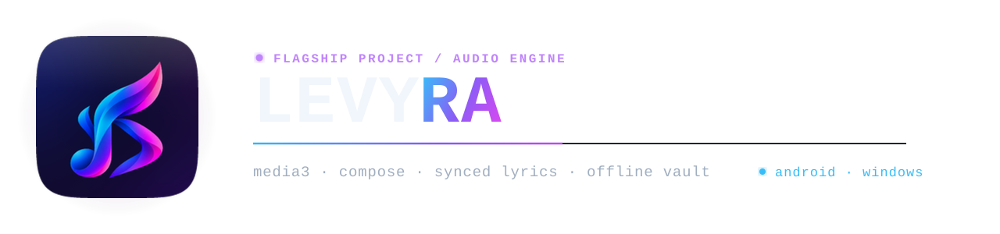
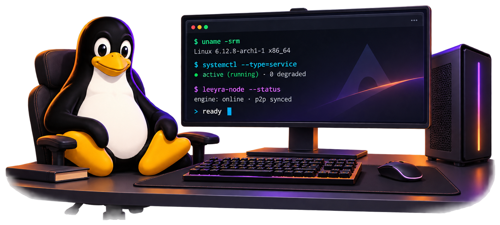

<picture>
  <source media="(prefers-color-scheme: dark)" srcset="./assets/brand/luc4n3x-logo-dark.webp">
  <source media="(prefers-color-scheme: light)" srcset="./assets/brand/luc4n3x-logo.webp">
  
</picture>

Independent software developer in Italy building Android apps and desktop audio software.

  <a href="https://luc4n3x.pages.dev">Website</a> ·
  <a href="https://levyra.dpdns.org">Levyra</a> ·
  <a href="https://github.com/LUC4N3X?tab=repositories">Repositories</a> ·
  <a href="https://github.com/sponsors/LUC4N3X">Sponsors</a> ·
  <a href="mailto:lucanex@proton.me">Email</a>

`Kotlin` · `Jetpack Compose` · `Compose Multiplatform` · `Media3` · `Python` · `Linux` · `Docker`

 

## About

I'm LUC4N3X, an independent developer based in Italy. Most of my work goes into Android apps, desktop audio software, and the Linux backend services behind them.

My main project is [Levyra](https://github.com/LUC4N3X/Levyra-deepsound), an open-source music player I maintain across Android, Windows and Linux. Outside of Levyra, I build media extraction pipelines, self-hosted tools, and workflow utilities like [antigravity-thalarch](https://github.com/LUC4N3X/antigravity-thalarch).

I prefer software that holds up on mid-range phones and keeps user data local.

 

## Featured project

<a href="https://github.com/LUC4N3X/Levyra-deepsound">
  <picture>
    <source media="(prefers-color-scheme: dark)" srcset="./assets/levyra/levyra-lockup-dark.svg">
    <source media="(prefers-color-scheme: light)" srcset="./assets/levyra/levyra-lockup.svg">
    
  </picture>
</a>

  <a href="https://github.com/LUC4N3X/Levyra-deepsound"><strong>Repository</strong></a> ·
  <a href="https://github.com/LUC4N3X/Levyra-deepsound/releases/latest"><strong>Latest release</strong></a> ·
  <a href="https://levyra.dpdns.org"><strong>Website</strong></a> ·
  <a href="https://levyra.dpdns.org/docs/"><strong>Docs</strong></a> ·
  <a href="https://hosted.weblate.org/engage/levyra/"><strong>Weblate</strong></a>

  
  
  

Levyra is an open-source music player built for listening without an account. It runs on Android, Windows and Linux, combining streamed tracks and local audio files in one library. Android playback runs on AndroidX Media3 and ExoPlayer, desktop builds use Compose Multiplatform with libVLC, downloads are saved as ordinary audio files on your storage, and synced lyrics come from LRCLIB. It has no ads and no telemetry.

## Stack

My daily workstation runs Linux. I stick to dependable tools that behave predictably under load.

- **Client apps.** Kotlin, Jetpack Compose, Compose Multiplatform, AndroidX Media3, ExoPlayer and libVLC.
- **Backend and extraction.** Python with FastAPI and AsyncIO, plus Node.js and TypeScript for web services and tooling.
- **Storage and delivery.** SQLite and Room for offline-first local state, Redis for caching, Docker containers behind Cloudflare, and GitHub Actions for CI and releases.

 

## Engineering habits

Most of my projects start from a concrete annoyance I run into myself. Once the first version works, the real time goes into making it hold up in daily use.

- **Test on real hardware.** Background limits, audio focus and battery managers behave very differently on a mid-range Android phone than on an emulator, so playback changes get verified on physical devices.
- **Fix the root cause.** When a bug comes back, the first fix only masked it. I'd rather spend an evening reproducing a race condition than ship a retry wrapper around it.
- **Keep commits small and readable.** Each change targets one problem so `git blame` and release diffs stay useful six months later.

## GitHub activity

<a href="https://github.com/LUC4N3X?tab=overview">
  <picture>
    <source media="(prefers-color-scheme: dark)" srcset="./assets/stats/stats-dark.svg">
    <source media="(prefers-color-scheme: light)" srcset="./assets/stats/stats-light.svg">
    
  </picture>
</a>

 

<a href="https://github.com/LUC4N3X/Levyra-deepsound">
  <picture>
    <source media="(prefers-color-scheme: dark)" srcset="./assets/stats/pin-dark.svg">
    <source media="(prefers-color-scheme: light)" srcset="./assets/stats/pin-light.svg">
    
  </picture>
</a>

 

<a href="https://github.com/LUC4N3X?tab=repositories">
  <picture>
    <source media="(prefers-color-scheme: dark)" srcset="./assets/brand/how-i-build-dark.svg">
    <source media="(prefers-color-scheme: light)" srcset="./assets/brand/how-i-build.svg">
    
  </picture>
</a>

GitHub Developer Program · Bug reports go on the relevant repo issue tracker · Direct contact: <a href="mailto:lucanex@proton.me">lucanex@proton.me</a>

