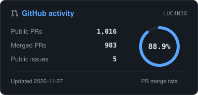

<picture>
  <source media="(prefers-color-scheme: dark)" srcset="./assets/brand/luc4n3x-logo-dark.webp">
  <source media="(prefers-color-scheme: light)" srcset="./assets/brand/luc4n3x-logo.webp">
  
</picture>

Independent developer in Italy · Android, desktop audio, Linux

  <a href="https://luc4n3x.pages.dev">Website</a> ·
  <a href="https://levyra.dpdns.org">Levyra</a> ·
  <a href="https://github.com/LUC4N3X?tab=repositories">Repositories</a> ·
  <a href="https://github.com/sponsors/LUC4N3X">Sponsors</a> ·
  <a href="mailto:lucanex@proton.me">Email</a>

## About

I'm LUC4N3X, based in Italy.

Most of my time goes into [Levyra](https://github.com/LUC4N3X/Levyra-deepsound), an open-source music player for Android, Windows and Linux. Alongside that, I work on media extraction, Linux backend services, and [antigravity-thalarch](https://github.com/LUC4N3X/antigravity-thalarch).

I test playback on real mid-range phones and keep user data local. If something breaks in one of my repos, open an issue.

 

## Levyra

<a href="https://github.com/LUC4N3X/Levyra-deepsound">
  <picture>
    <source media="(prefers-color-scheme: dark)" srcset="./assets/levyra/levyra-lockup-dark.svg">
    <source media="(prefers-color-scheme: light)" srcset="./assets/levyra/levyra-lockup.svg">
    
  </picture>
</a>

  <a href="https://github.com/LUC4N3X/Levyra-deepsound">Repository</a> ·
  <a href="https://github.com/LUC4N3X/Levyra-deepsound/releases/latest">Releases</a> ·
  <a href="https://levyra.dpdns.org">Website</a> ·
  <a href="https://levyra.dpdns.org/docs/">Docs</a> ·
  <a href="https://hosted.weblate.org/engage/levyra/">Weblate</a>

  
  
  

It keeps streamed tracks and local audio files in one library, saves offline downloads as plain audio files, and pulls synced lyrics from LRCLIB. It needs no account and has no ads or telemetry.

Android runs on Kotlin, Jetpack Compose and AndroidX Media3; Windows and Linux builds use Compose Multiplatform and libVLC.

## Stack

Daily driver is Linux.

- Android & desktop: `Kotlin`, `Jetpack Compose`, `Compose Multiplatform`, `Media3`, `libVLC`
- Backend & tooling: `Python`, `FastAPI`, `AsyncIO`, `Node.js`, `TypeScript`
- Data & infra: `SQLite`, `Room`, `Redis`, `Docker`, `Cloudflare`, `GitHub Actions`

 

## Activity

<a href="https://github.com/LUC4N3X?tab=overview">
  <picture>
    <source media="(prefers-color-scheme: dark)" srcset="./assets/stats/stats-dark.svg">
    <source media="(prefers-color-scheme: light)" srcset="./assets/stats/stats-light.svg">
    
  </picture>
</a>

 

<a href="https://github.com/LUC4N3X/Levyra-deepsound">
  <picture>
    <source media="(prefers-color-scheme: dark)" srcset="./assets/stats/pin-dark.svg">
    <source media="(prefers-color-scheme: light)" srcset="./assets/stats/pin-light.svg">
    
  </picture>
</a>

 
 

<a href="https://github.com/LUC4N3X?tab=repositories">
  <picture>
    <source media="(prefers-color-scheme: dark)" srcset="./assets/brand/how-i-build-dark.svg">
    <source media="(prefers-color-scheme: light)" srcset="./assets/brand/how-i-build.svg">
    
  </picture>
</a>

GitHub Developer Program · <a href="mailto:lucanex@proton.me">lucanex@proton.me</a>

