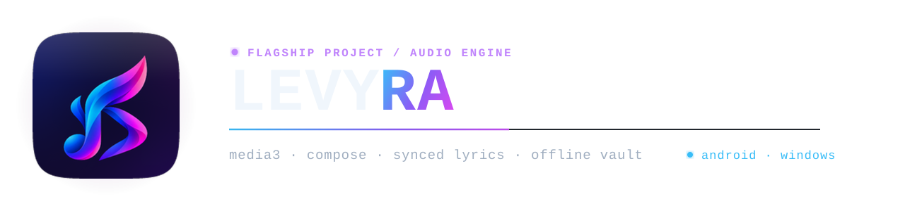
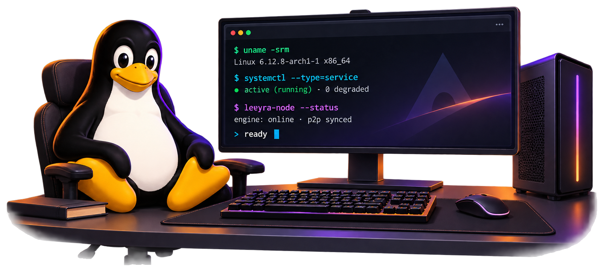

<picture>
  <source media="(prefers-color-scheme: dark)" srcset="./assets/brand/luc4n3x-logo-dark.webp">
  <source media="(prefers-color-scheme: light)" srcset="./assets/brand/luc4n3x-logo.webp">
  
</picture>

I build software I want to use, and keep working on it until it feels right.

 

[luc4n3x.pages.dev](https://luc4n3x.pages.dev) · Personal site and notes

 

`Android` · `Kotlin` · `Jetpack Compose` · `Python` · `APIs` · `Docker`

 

## About me

Hey, I'm LUC4N3X. I build software for myself and keep at it until it actually works the way I want.

Most of my time goes into Android apps, backend APIs, and small self-hosted tools. Getting a feature to run the first time is usually the easy part. What I actually enjoy is everything that comes after: chasing down the weird edge cases, fixing bugs that only show up on one obscure phone, and stripping out complexity until the code is straightforward.

A lot of my ideas end up in Levyra, my open-source music player. When I am not working on that, I am usually tinkering with local-first setups, audio pipelines, or small Linux utilities.

 

---

## Featured project

<a href="https://github.com/LUC4N3X/Levyra-deepsound">
  <picture>
    <source media="(prefers-color-scheme: dark)" srcset="./assets/levyra/levyra-lockup-dark.svg">
    <source media="(prefers-color-scheme: light)" srcset="./assets/levyra/levyra-lockup.svg">
    
  </picture>
</a>

 

  <a href="https://github.com/LUC4N3X/Levyra-deepsound"><strong>Repository</strong></a> ·
  <a href="https://github.com/LUC4N3X/Levyra-deepsound/releases/latest"><strong>Latest release</strong></a> ·
  <a href="https://levyra.dpdns.org"><strong>Website</strong></a>

Levyra started because I wanted a music player that didn't demand an account just to save playlists or stream tracks. It runs on Android and Windows, plays local and remote audio through native engines (Media3 on Android, libvlc on Windows), downloads real M4A files to your storage, and pulls synced lyrics from LRCLIB. Everything stays on your device, with no telemetry or tracking.

---

## Technologies I work with

My daily setup runs entirely on Linux. I stick to tools that stay predictable when things get complicated:

On Android, I write Kotlin and Jetpack Compose for the UI, with AndroidX Media3 and ExoPlayer handling background playback sessions without dropping audio. On the backend, I use Python with FastAPI and AsyncIO for APIs and background tasks, plus Node.js for smaller scrapers and web utilities. Data stays in SQLite and Room for local offline storage, with Redis when caching speed matters. Everything runs in Docker containers behind Cloudflare, deployed through GitHub Actions.

 

---

## How I build

I rarely start from a diagram. I start from something that annoys me, build the smallest version that fixes it, and then use it every day until the rough edges show up. Most of the real work happens in that second part.

A few habits that have stuck over the years:

- **Real devices, not just emulators.** Playback, background limits, and battery drain behave very differently on a mid-range phone with aggressive power saving, so that is where things get tested.
- **Make it work, then make it simple.** The first version is allowed to be messy. The one I ship should still make sense to me six months from now.
- **Fix the cause, not the symptom.** If a bug comes back, I did not understand it the first time. I would rather spend an evening reproducing it than ship a workaround.
- **Small, honest commits.** Each change does one thing and says what it does, so the history actually helps when something breaks.
- **Polish comes last, but it does come.** Once the foundation holds, I go back for the details: smooth transitions, sensible empty states, and error messages a person can actually understand.

If something I built turns out to be useful to you, or you run into a bug I missed, open an issue. That kind of feedback is how most of my projects got better.

 

<a href="https://github.com/LUC4N3X?tab=repositories">
  <picture>
    <source media="(prefers-color-scheme: dark)" srcset="./assets/brand/how-i-build-dark.svg">
    <source media="(prefers-color-scheme: light)" srcset="./assets/brand/how-i-build.svg">
    
  </picture>
</a>

